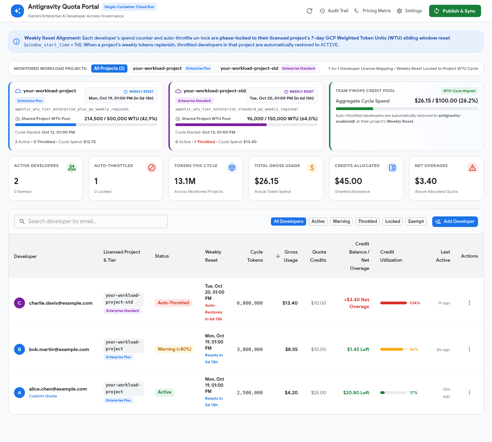
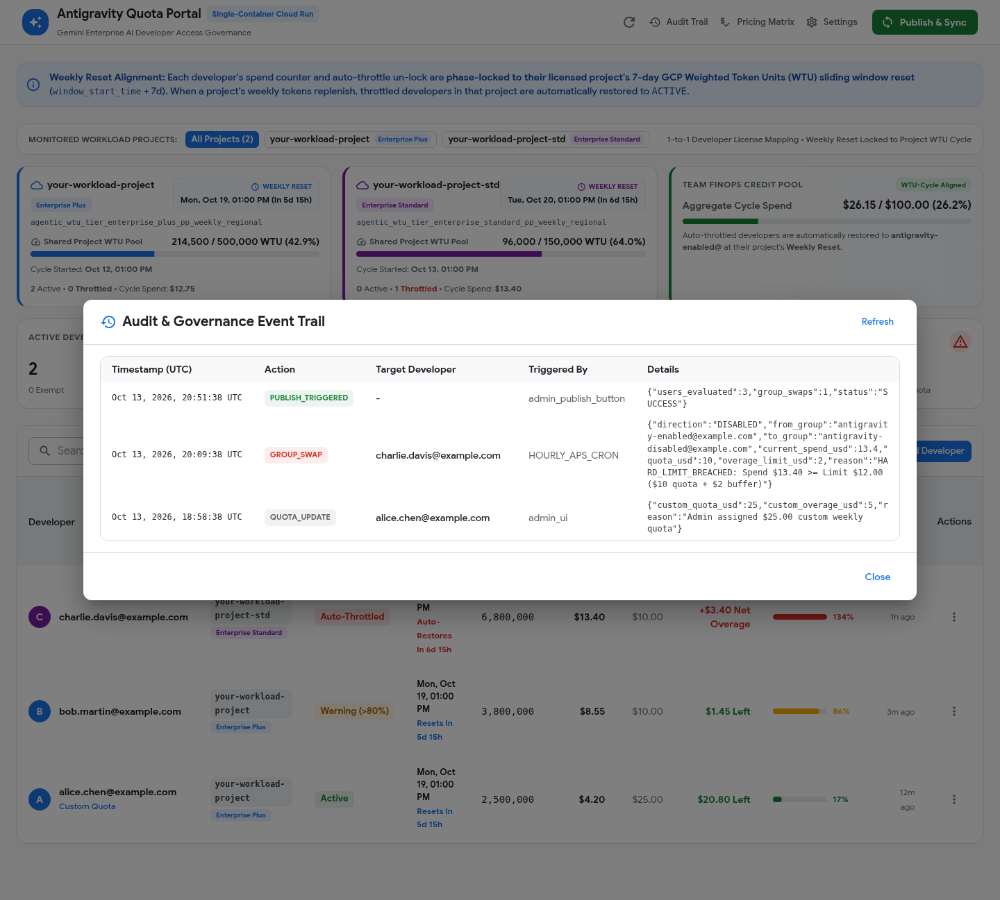
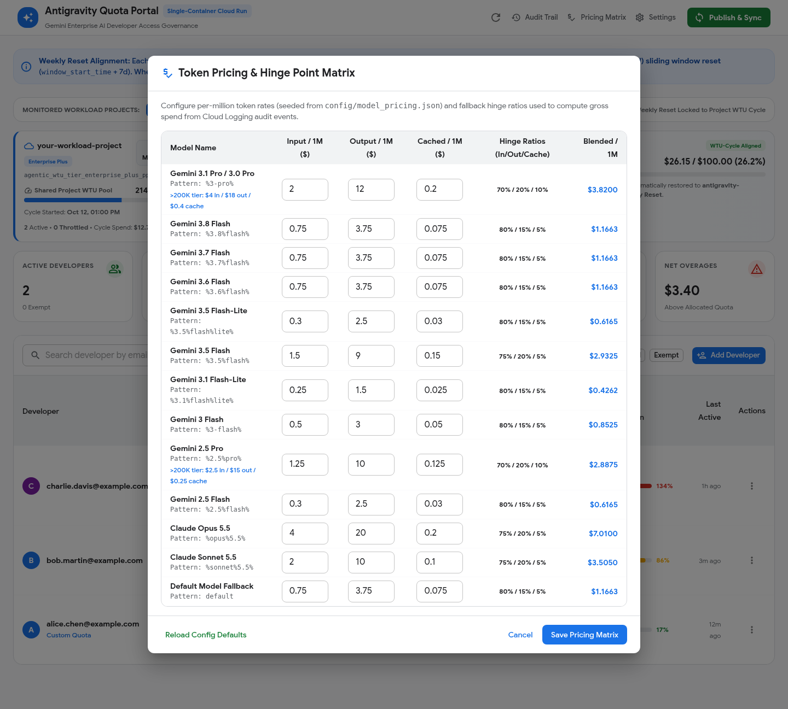
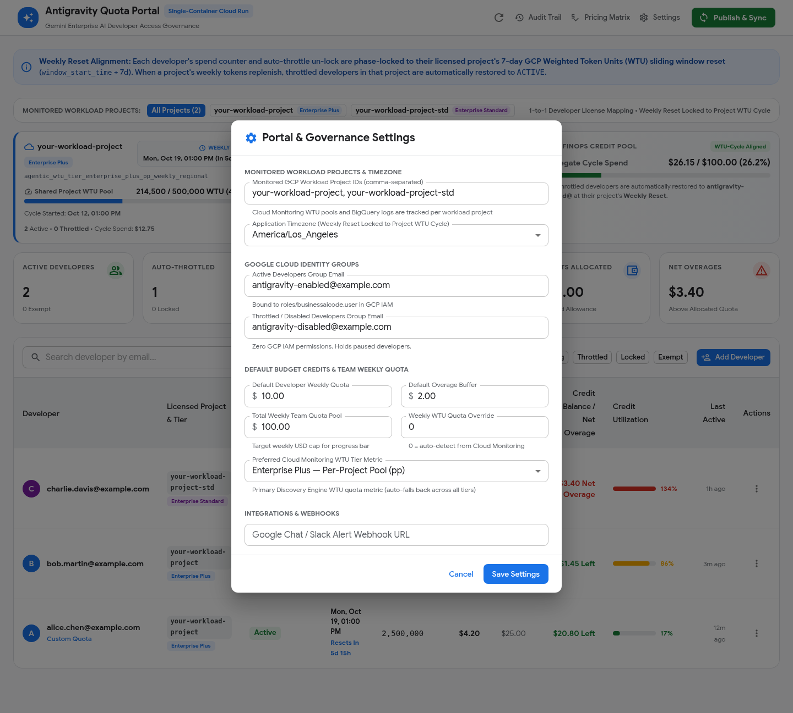
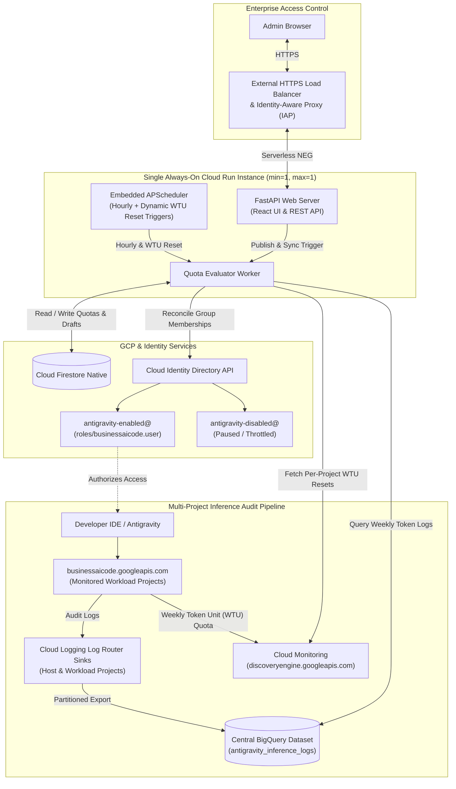
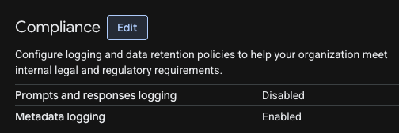

# Antigravity Quota & Usage Management Portal

> [!IMPORTANT]  
> This project is not provided by Google and does not come with any support or warranties. This project serves as a proof of concept for how it's possible implement a quota system with Antigravity.  
> Though functional, you may wish to change the design for increased reliability or feature detail.  

> [!IMPORTANT]  
> Accurate as of 10/12/2026  

> [!NOTE]
> **Per-Developer FinOps Governance Phase-Locked to GCP WTU Cycles**: Gemini Enterprise enforces Weighted Token Units (WTU) quota as a shared pool at the GCP workload project level (`Enterprise Plus` or `Enterprise Standard`). This portal reads live Cloud Monitoring WTU telemetry (`discoveryengine.googleapis.com/quota/ratev2/...`) across your monitored workload projects to phase-lock each developer's **Weekly Reset** to their licensed project's 7-day WTU sliding window (`window_start_time + 7d`), while enforcing granular per-developer USD quota targets via Cloud Identity groups (`antigravity-enabled@` and `antigravity-disabled@`) and BigQuery inference audit logs.

**What this is**  
- a single-container, deployed to GCP Cloud Run, and Terraform IaC module (`us-east5` default)
- a frontend: React 18 SPA (Vite, TypeScript, Material UI / MUI)
- an API: FastAPI (Python 3.11+) with Uvicorn and embedded APScheduler
- data storage & telemetry: Cloud Firestore Native (quotas & config), BigQuery (inference audit logs across monitored workload projects), and Cloud Monitoring (live Discovery Engine WTU pool utilization & 7-day sliding reset clocks)

**Why this exists**
- Gemini Enterprise manages WTU quota pools per GCP workload project rather than enforcing individual per-developer spend caps

**What this is not**
- **Not a modification to internal Google Cloud Quotas enforcement**: While the portal reads live project-level WTU consumption and 7-day reset timestamps from Cloud Monitoring, per-developer dollar quotas are enforced independently by swapping developers between `antigravity-enabled@` and `antigravity-disabled@` Cloud Identity groups based on BigQuery inference log telemetry.
- **Not a GCP billing or invoicing engine**: Because Gemini Enterprise pools WTU quota across each licensed GCP workload project, an individual developer exceeding their internal credit allowance does not necessarily trigger external Google Cloud billing if total project consumption remains within its pooled WTU entitlement.

**How it works**
- each developer is licensed (`Enterprise Plus` or `Enterprise Standard`) in a monitored GCP workload project (`1-to-1` developer-to-project mapping)
- developers are added and removed from Cloud Identity groups (`antigravity-enabled@` and `antigravity-disabled@`) to enable and disable `roles/businessaicode.user` access for Antigravity
- an `hourly_quota_evaluator`, dynamic one-shot WTU cycle reset triggers, and on-demand **Publish & Sync** perform automated dual-group reconciliation
- **auto-throttled** developers automatically unlock and return to `antigravity-enabled@` on the next evaluation (or instantly upon clicking **Publish & Sync**) whenever an admin increases their quota or overage buffer
- **Weekly Reset** is phase-locked to each workload project's 7-day GCP WTU sliding cycle reset (`window_start_time + 604,800s`), archiving a snapshot, resetting cycle spend to `$0.00`, and automatically restoring `AUTO_DISABLED` developers to `ACTIVE` the moment their project's weekly tokens replenish
- **manually locked** developers are protected administrative holds that remain disabled across Weekly Resets until an admin explicitly unlocks them

**Features**
1. **FinOps Credit, Context-Tiered Pricing & Developer Overage Model**:
    * Quotas are allocated as weekly dollar credits (`Q`, default `$10.00`) with remaining credit balance `B_credit = max(0, Q - C_gross)`.
    * Developer overage tracks usage beyond their assigned quota target: `C_overage = max(0, C_gross - Q)` with configurable overage buffer (`O`).
    * **Granular Token Telemetry & Context-Length Tiered Pricing (`>200k` tokens)**: Calculates gross spend directly from the exact token counts emitted in Antigravity inference logs (`metadata.promptTokenCount`, `metadata.candidatesTokenCount`, `metadata.cachedContentTokenCount`, and `metadata.thoughtsTokenCount`), applying standard (`<=200k` prompt tokens) and long-context (`>200k` prompt tokens) pricing tiers from [`config/model_pricing.json`](config/model_pricing.json).
    * **WTU-Locked Weekly Reset Windows**: Cycle boundaries track each project's active 7-day WTU sliding window (`wtu_window_start_at` to `wtu_window_reset_at`, with calendar Monday `00:00` fallback when WTU metrics are inactive) and archive historical snapshots to Firestore.
2. **Dual-Group Cloud Identity State Machine**:
    * **`antigravity-enabled@`**: Bound to IAM role `roles/businessaicode.user` across all monitored workload projects.
    * **`antigravity-disabled@`**: Zero IAM permissions (paused developers).
    * **Full Dual-Group Drift & Failure Recovery**: Verifies membership across both groups on every evaluation run, removes duplicate memberships if a user appears in both groups, excludes `.gserviceaccount.com` principals, and rolls back Firestore status transitions if a Cloud Identity API call fails so the next run automatically retries.
    * **Dynamic Auto-Unthrottle (Quota Expansion)**: If an `Auto-Throttled` developer's quota credits or overage buffer is increased so that $\text{Spend} < \text{Limit}$, the evaluator (or clicking **Publish & Sync**) automatically restores their `ACTIVE` status and moves them back to `antigravity-enabled@`.
    * **WTU-Synchronized Weekly Reset**: When a workload project's 7-day WTU cycle resets, a dynamic APScheduler one-shot job (`wtu_reset_<project_id>`) fires within 5 seconds of reset to restore `Auto-Throttled` developers in that project back into `antigravity-enabled@`.
    * **Administrative Lock Protection**: Distinguishes automated spend limits from `MANUALLY_DISABLED` (administrative locks that are protected from Weekly Resets and remain locked until explicitly unlocked by an admin).
    * **Quota Exemption**: Supports `is_exempt` to bypass quota limits for leads/VIPs while retaining full usage analytics.
3. **Multi-Project & Multi-Tier (`Enterprise Plus` / `Enterprise Standard`) Governance**:
    * Monitors multiple GCP workload projects (`WORKLOAD_PROJECT_IDS` / `monitored_projects`) from a single host portal project.
    * Automatically detects each project's Gemini Enterprise license tier (`Enterprise Plus` vs. `Enterprise Standard`) from Cloud Monitoring WTU metrics and attributes developers to their licensed project via BigQuery log metadata (`resource.labels.project_id`).
    * Displays per-project WTU pool cards with independent **Weekly Reset** countdowns and an interactive workload project filter bar.
4. **Developer Onboarding & Synthetic Discovery**:
    * **Synthetic Discovery**: Automatically discovers active human developers from BigQuery inference logs (ignoring service accounts) and registers them with default weekly quota credits, project attribution, and license tier.
    * **Manual Pre-provisioning**: Admins can pre-provision developers in the UI or via REST API with custom quotas and workload project assignment prior to their first prompt.
5. **Per-User Immediate Sync & Full-Org Publish**:
    * Saving user edits (`PATCH /api/users/{email}`) persists changes to Firestore and immediately reconciles that user's Cloud Identity group membership; updating default quota/overage settings (`PUT /api/config`) immediately recalculates non-custom users' ledgers, evaluates state transitions, and reconciles Cloud Identity groups; and updating or resetting the model pricing matrix (`PUT /api/config/pricing`, `POST /api/config/pricing/reset`) immediately recalculates all users' spend, state, and group memberships in real time.
    * Clicking **"Publish & Sync"** (`POST /api/evaluator/publish`) triggers an immediate full-org BigQuery telemetry evaluation and Cloud Identity group sync across all developers in real-time (<2s).
    * Built-in `APScheduler` runs hourly evaluations plus exact one-shot triggers at each project's WTU reset timestamp.
6. **Material Design 3 (MUI) Dashboard**:
    * Pinned Weekly Reset alignment banner explaining 7-day WTU cycle phase-locking.
    * Per-project WTU Pool & **Weekly Reset** cards alongside the Team FinOps Credit Pool card and 6 real-time KPI summary cards.
    * Sortable, project-filterable developer table with **Licensed Project & Tier** badges, per-developer **Weekly Reset** timestamps, and color-coded credit utilization progress bars.
    * Interactive slide-out drawer with financial ledger, model token distribution, granular input/output/thoughts/cached breakdown, and custom quota controls.
    * Governance audit trail log viewer and model pricing matrix editor with one-click **Reload Config Defaults** (`config/model_pricing.json`).
7. **Enterprise Security & Automated Hub-and-Spoke Infrastructure**:
    * Provisions host project APIs, BigQuery dataset, per-workload-project Cloud Logging Sinks (`for_each = toset(var.monitored_project_ids)`), workload project `roles/businessaicode.user` and `roles/monitoring.viewer` bindings, Firestore Native Database, Service Account, Artifact Registry repository, and Cloud Run v2 service via Terraform (`terraform/`).
    * **Zero-Trust Access with IAP**: Full External HTTPS Application Load Balancer integrated with Google Identity-Aware Proxy (IAP) and least-privilege IAM for secure, browser-based SSO.
    * **Automated `sslip.io` DNS & Managed SSL**: Automatically provisions Google-managed SSL certificates using derived `sslip.io` hostnames (e.g. `<LB_IP>.sslip.io`) without requiring a custom domain, with optional custom domain override support.
    * **Local Sandbox & Mock Mode**: Runs out-of-the-box with `USE_MOCK_SERVICES=true` without requiring live GCP credentials.

---

## Visual Tour & Interface

### Developer Access & Quota Dashboard


### Audit & Governance Event Trail
Real-time dual-written audit trail tracking group swaps, manual locks, admin publishes, and quota updates.


### Token Pricing & Hinge Point Matrix
Dynamic per-million token rates and input/output/cached hinge point ratios for accurate gross spend estimation.


### Portal & Governance Settings
Configurable weekly budget boundaries, application timezones, Cloud Identity groups, and alert webhook endpoints.


---

## Architecture Overview



---

## Antigravity Inference Log Schema & Token Telemetry

> [!IMPORTANT]  
> **Mandatory Workload Prerequisite: Enable Metadata Logging in Gemini Enterprise**  
> In order for Antigravity to emit token usage telemetry, each monitored workload project must have **Metadata logging** enabled. In Google Cloud, this setting defaults to **Disabled**.
>
> 1. In the Google Cloud Console for the monitored workload project, navigate to:  
>    **Gemini Enterprise** &rarr; **Settings** &rarr; **AI developer tools**  
>    *(Direct URL: `https://console.cloud.google.com/gemini-enterprise/settings/ai-developer-tools?project=<WORKLOAD_PROJECT_ID>`)*
> 2. Under the **Compliance** section, click **Edit**.
> 3. Toggle **Metadata logging** to **Enabled** and click **Save**.  
>    *(Note: **Prompts and responses logging** can safely remain **Disabled**; the portal only requires token usage counters from metadata).*
>
> <p align="center">
>   
> </p>
>
> *Without Metadata logging enabled, Google Cloud only emits standard Cloud Audit logs (`cloudaudit.googleapis.com/data_access`), which record authorization and method names (`StreamGenerateContent`) but **omit** token usage metrics. The dedicated `businessaicode.googleapis.com/inference_response` log stream will not be generated, resulting in 0 tokens recorded in BigQuery and on the portal.*

Inference telemetry is exported from Cloud Logging to BigQuery via the log sink from `businessaicode.googleapis.com/inference_response`. Each log entry provides a structured `jsonpayload_v1_inferenceresponselog.metadata` payload containing granular token telemetry per request:

```json
"metadata": {
  "totalTokenCount": 8664,
  "promptTokenCount": 7200,
  "candidatesTokenCount": 1400,
  "cachedContentTokenCount": 256,
  "thoughtsTokenCount": 64,
  "truncated": false
}
```

### Telemetry Field Breakdown

| Log Field | Type | Description & Billing Mapping |
| :--- | :---: | :--- |
| `promptTokenCount` | `int64` | **Input / Prompt Tokens**: Total input tokens submitted in the request (prompts, instructions, tool declarations). Billed at model input price $P_{\text{in}}$. |
| `candidatesTokenCount` | `int64` | **Output / Candidate Tokens**: Generation tokens produced by the model across response candidates. Billed at model output price $P_{\text{out}}$. |
| `cachedContentTokenCount` | `int64` | **Cached Context Tokens**: The subset of prompt tokens served from Gemini Context Caching. Billed at the discounted cache read rate $P_{\text{cached}}$ rather than full input price. |
| `thoughtsTokenCount` | `int64` | **Reasoning / Thinking Tokens**: Internal reasoning/chain-of-thought tokens produced during inference (e.g. Gemini 3.8 Flash / Gemini 2.5 Pro). Billed under output token pricing. |
| `totalTokenCount` | `int64` | **Total Token Volume**: Combined token sum for the inference call: $\text{totalTokenCount} = \text{promptTokenCount} + \text{candidatesTokenCount} + \text{thoughtsTokenCount}$ (e.g. $7200 + 1400 + 64 = 8664$; note that `cachedContentTokenCount` is a 256-token subset already included within the 7,200 `promptTokenCount`). |
| `truncated` | `bool` | **Truncation Flag**: Indicates whether generation was truncated due to token limit (`max_output_tokens`) or safety cutoff. |

### Granular Spend Calculation

Using this telemetry, exact gross spend is determined without relying on arbitrary synthetic ratios:

$$\text{Effective Input Tokens} = \max(0, \text{promptTokenCount} - \text{cachedContentTokenCount})$$
$$\text{Cached Tokens} = \text{cachedContentTokenCount}$$
$$\text{Output Tokens} = \text{candidatesTokenCount} + \text{thoughtsTokenCount}$$

$$C_{\text{gross}} = \left( \frac{\text{Effective Input}}{1{,}000{,}000} \times P_{\text{in}} \right) + \left( \frac{\text{Cached}}{1{,}000{,}000} \times P_{\text{cached}} \right) + \left( \frac{\text{Output}}{1{,}000{,}000} \times P_{\text{out}} \right)$$

> [!NOTE]  
> If an older log record or summarized entry only provides `totalTokenCount` (with granular sub-counts missing or null), the system gracefully falls back to the per-model estimated ratios ($w_{\text{in}}, w_{\text{out}}, w_{\text{cached}}$) defined in the model pricing matrix.

### Sharded & Partitioned BigQuery Sink Tables

Cloud Logging sinks exporting `businessaicode.googleapis.com/inference_response` create date-sharded tables (`businessaicode_googleapis_com_inference_response_YYYYMMDD`) by default, or a single time-partitioned table (`businessaicode_googleapis_com_inference_response`) when `use_partitioned_tables = true` is configured in Terraform. `BigQueryUsageClient` queries both the wildcard sharded tables (`businessaicode_googleapis_com_inference_response_*` with `_TABLE_SUFFIX` date pruning) and the time-partitioned table (`businessaicode_googleapis_com_inference_response`), combining records when both exist so zero events are dropped during sink migrations. Each record also extracts the originating workload project via `COALESCE(resource.labels.project_id, REGEXP_EXTRACT(logName, r'^projects/([^/]+)/'))`.

### Cloud Monitoring WTU Telemetry & Weekly Quota Reset Banner

In addition to BigQuery token cost tracking, the portal queries Google Cloud Monitoring ([`projects.timeSeries.list`](https://cloud.google.com/monitoring/api/ref_v3/rest/v3/projects.timeSeries/list)) for official **Weighted Token Units (WTU)** quota metrics published under the [`discoveryengine.googleapis.com` metrics catalog](https://cloud.google.com/monitoring/api/metrics_gcp_d_h#gcp-discoveryengine) and visible in the Google Cloud Console under [**IAM & Admin &rarr; Quotas & System Limits**](https://cloud.google.com/docs/quotas/view-manage) (see also [Gemini Enterprise / Discovery Engine Quotas & Limits](https://cloud.google.com/generative-ai-app-builder/docs/quotas)).

#### 1. WTU Quota Scopes, Official Display Names & Monitored Resources

Google Cloud Monitoring exposes two distinct WTU quota scopes (`quota/ratev2/...`) across both `enterprise_plus` and `enterprise_standard` tiers:

| Scope | Metric Prefix (`discoveryengine.googleapis.com/quota/ratev2/...`) | Official Cloud Quotas Display Name | Monitored Resource | Resource & Metric Labels |
| :--- | :--- | :--- | :--- | :--- |
| **Shared Project Pool (`pp`)** | `agentic_wtu_tier_enterprise_{plus,standard}_pp_weekly_regional` | *Number of agentic services WTUs weekly per-project for enterprise {plus,standard} tier* | `discoveryengine.googleapis.com/Location` | `project_id`, `location`, `window_start_time` |
| **Per-Project Per-User (`pppu` / `ppu`)** | `agentic_wtu_tier_enterprise_{plus,standard}_{pppu,ppu}_weekly_regional` | *Per-user agentic services WTUs weekly for enterprise {plus,standard} tier* | `discoveryengine.googleapis.com/LocalizedUser` | `project_id`, `location`, `ge_user`, `window_start_time` |

#### 2. Sub-Metrics (`net_usage`, `limit`, `exceeded`) & Utilization Math

Each WTU tier prefix exposes three companion metric suffixes in the [Discovery Engine Metrics Reference](https://cloud.google.com/monitoring/api/metrics_gcp_d_h#gcp-discoveryengine):

| Metric Suffix | Kind / Type | Description |
| :--- | :---: | :--- |
| `/net_usage` | `GAUGE` (`INT64`) | Current Weighted Token Units (WTUs) consumed within the active 7-day sliding window. |
| `/limit` | `GAUGE` (`INT64`) | Total WTU quota limit configured for the project pool (`Location`) or individual user (`LocalizedUser`). |
| `/exceeded` | `DELTA` (`INT64`) | Count of requests rejected due to exceeding the weekly WTU quota limit. |

$$\text{WTU Utilization \%} = \left( \frac{\text{net\_usage}}{\text{limit}} \right) \times 100$$

> [!TIP]
> Administrators can also set a manual **Weekly WTU Quota Override** in **Portal Settings** (or leave it at `0` to auto-detect `/limit` from Cloud Monitoring).

#### 3. 7-Day Sliding Window Reset (`window_start_time`)

Unlike fixed calendar-week quotas, Discovery Engine WTU quotas use a **7-day sliding window** (`604,800` seconds) anchored to the first inference request in the cycle. Every active `/net_usage` time series carries a `metric.labels.window_start_time` Unix epoch timestamp:

$$\text{WTU Window Reset (UTC)} = \text{window\_start\_time} + 604{,}800\text{ seconds (7 days)}$$

#### 4. Per-Project WTU Pool Cards & WTU-Locked Weekly Reset

The dashboard displays per-project WTU pool cards and a workload project filter bar above the KPI summary cards:
1. **Per-Project WTU Pool & Weekly Reset Cards**: For each monitored workload project (`monitored_project_ids`), displays the detected Gemini Enterprise license tier (`Enterprise Plus` or `Enterprise Standard`), live WTU `net_usage` vs. `limit` (`% of WTU quota used`), active/throttled developer count, cycle USD spend, and the project's **Weekly Reset** timestamp (`window_start_time + 7 days`).
2. **WTU-Locked Weekly Reset Governance**: Both the BigQuery spend aggregation window and the automatic un-throttling of `AUTO_DISABLED` developers are phase-locked to each developer's licensed project **Weekly Reset** timestamp (`wtu_window_reset_at`), with dynamic one-shot APScheduler triggers (`wtu_reset_<project_id>`) firing 5 seconds after each project's 7-day WTU cycle resets.
3. **Developer Table Attribution**: Each developer row shows their **Licensed Project & Tier** badge and their exact **Weekly Reset** timestamp (`Resets in Xd Yh` or `Auto-Restores in Xd Yh`).

#### 5. Cloud Monitoring API Query Pattern, Caching & Frequency ($O(1)$ User Scaling)

Querying Cloud Monitoring for WTU telemetry scales as **$O(1)$** with respect to the number of developers in the portal (whether there are 10, 100, or 1,000 users) and is protected by a **15-second in-memory TTL cache** (`cache_ttl_seconds = 15.0`):

- **Per-Project Multi-Tier Discovery (No Per-User Loop):** `CloudMonitoringWTUClient` queries the project-wide [`projects.timeSeries.list`](https://cloud.google.com/monitoring/api/ref_v3/rest/v3/projects.timeSeries/list) endpoint across candidate WTU tiers without filtering by individual user:
  1. `GET .../timeSeries?filter=metric.type=".../net_usage"` — Returns a single time series for Shared Pool (`pp`) tiers, or all active user time series (`resource.labels.ge_user`) in a single bulk JSON response (with automatic pagination) for Per-User (`pppu` / `ppu`) tiers.
  2. `GET .../timeSeries?filter=metric.type=".../limit"` — Returns the configured WTU quota limit in a single response once an active `/net_usage` tier is matched (or probes candidate limit tiers when idle).
  - **Request Volume per Uncached Project Fetch:** **2** requests for an active `Enterprise Plus` project (matches the first candidate tier `enterprise_plus_pp` + its `/limit`), **3** requests for an active `Enterprise Standard` project (probes `enterprise_plus_pp`, matches `enterprise_standard_pp` + its `/limit`), and **7–12** requests for a completely idle project (6 `/net_usage` candidate tier probes followed by 1–6 `/limit` fallback probes).
- **15-Second In-Memory TTL Cache (`cache_ttl_seconds = 15.0`):**
  - Subsequent `fetch_wtu_status()` calls for the same `(project_id, preferred_tier, configured_wtu_limit)` within 15 seconds are served directly from memory (**0 Cloud Monitoring requests**), preventing redundant API calls when `POST /api/evaluator/publish` is immediately followed by `GET /api/evaluator/kpis`.
- **When the API is Called:**
  - **Initial Dashboard Load:** `GET /api/evaluator/kpis` is called once when the portal opens.
  - **Explicit Admin Actions:** Triggered when clicking **Refresh**, **Publish & Sync**, or saving a user/settings update (deduplicated within the 15s TTL window).
  - **Inspecting Users in the Drawer:** Clicking any developer row to open the detailed `UserDrawer` reads the already-loaded `User` state in browser memory (**0 Cloud Monitoring requests**).
  - **No Background Browser Polling:** The frontend does not run a `setInterval` polling loop against `/api/evaluator/kpis`, keeping Cloud Monitoring read volume well under the standard GCP quota of 1,200 read requests per minute (20 QPS).

---

## Project Structure

```
antigravity-quota-portal/
├── SPECIFICATION.md
├── migrationplan.md             # Migration guide for BigQuery, Sinks, Firestore & Terraform
├── pyproject.toml               # Python package configuration
├── Dockerfile                   # Multi-stage container build
├── Containerfile                # Podman container definition
├── README.md
├── config/
│   └── model_pricing.json       # Externalized model pricing catalog (<=200k & >200k tiers)
├── terraform/                   # Terraform IaC Module
│   ├── main.tf                  # Providers & APIs
│   ├── bigquery.tf              # Central Dataset & Per-Workload-Project Cloud Logging Sinks
│   ├── firestore.tf             # Firestore Native Database
│   ├── iam.tf                   # Service Account, Workload Monitoring & Group IAM
│   ├── cloud_run.tf             # Artifact Registry & Cloud Run v2 Service
│   ├── lb.tf                    # External HTTPS Load Balancer & IAP
│   ├── variables.tf             # Inputs (including monitored_project_ids)
│   ├── outputs.tf               # Resource endpoints
│   └── terraform.tfvars.example # Example configuration
├── scripts/
│   ├── auth-dev1.sh             # Isolated dev1 CLI authentication helper
│   ├── auth-dev2.sh             # Isolated dev2 CLI authentication helper
│   ├── build_and_push.sh        # Podman build & push script
│   ├── capture_screenshot.py    # Headless Chrome dashboard screenshot capture
│   ├── deploy_cloudbuild.sh     # Cloud Build deployment automation script
│   ├── deploy_terraform.sh      # OpenTofu / Terraform deploy script
│   ├── run_local_demo.py        # Local sandbox runner (seeds 3 demo users)
│   ├── security_scan.sh         # Security & secret scan script
│   ├── seed_demo_data.py        # REST API demo user seeder script
│   ├── simulate_lifecycle.py    # Multi-user quota lifecycle simulator script
│   └── test_ge_quota_exhaustion.py # Gemini Enterprise WTU exhaustion test script
├── frontend/                    # Material UI React Application
│   ├── package.json
│   ├── vite.config.ts
│   ├── index.html
│   └── src/
│       ├── main.tsx
│       ├── App.tsx
│       ├── theme.ts             # Google Cloud Material 3 Theme
│       ├── components/          # UI Components
│       └── services/api.ts      # REST API Client
├── app/
│   ├── main.py                  # FastAPI Application & APScheduler (hourly + WTU reset triggers)
│   ├── config.py                # Environment configuration
│   ├── audit/                   # GCP Cloud Logging audit emitter & mock
│   ├── core/                    # Cost math, timezone engine, evaluator & state machine
│   ├── db/                      # Firestore client & Mock DB
│   ├── bq/                      # BigQuery client, Cloud Monitoring WTU client & Mocks
│   ├── identity/                # Cloud Identity client & Mock Identity
│   ├── api/                     # REST API routes
│   └── static/                  # Production static SPA bundle
└── tests/                       # Unit & Integration Tests
    ├── conftest.py              # Shared test fixtures & deterministic mock environment
    ├── simulation/              # Multi-user CLI isolation runner & lifecycle simulation tests
    ├── test_cost_model.py
    ├── test_timezone.py
    ├── test_state_machine.py
    ├── test_evaluator.py
    ├── test_audit_gcp.py
    └── test_api.py
```

---

## Local Development & Testing

### Initializing the Local Python Environment (`uv sync`)
Because `uv.lock` is git-ignored so developers and CI pipelines can resolve packages against either public PyPI (`https://pypi.org/simple`) or a corporate artifact mirror without index-URL conflicts, initialize your local virtual environment and lockfile first:
```bash
# Generate a local uv.lock and install all runtime + dev dependencies into .venv
uv sync --extra dev
```

### Running Tests & Rapid Verification
```bash
# Run backend pytest suite (90 tests)
uv run pytest -v tests/

# Run automated 6-stage end-to-end quota lifecycle simulation (<1s)
uv run python scripts/simulate_lifecycle.py
```

> [!TIP]
> For the complete minimal-command verification guide and checklist, see [**`docs/RUNBOOK.md`**](docs/RUNBOOK.md). For multi-user CLI credential isolation and testing with `dev1` and `dev2`, see [**`docs/MULTI_USER_TESTING.md`**](docs/MULTI_USER_TESTING.md).

### Running Locally in Mock Sandbox Mode

#### Option A: Dedicated 3-User Sandbox Runner (Recommended)
Launches the portal pre-seeded with **3 users** demonstrating each quota lifecycle state (Active Normal, Active Warning, and Auto-Throttled):
```bash
uv run scripts/run_local_demo.py
```
Open [http://localhost:8080](http://localhost:8080) to interact with the dashboard.

#### Option B: Standard Uvicorn / Podman Runner
```bash
# Direct via Python / uv (after running `uv sync`)
export USE_MOCK_SERVICES=true
uv run uvicorn app.main:app --reload --port 8080

# Or via Podman container
podman build -t antigravity-quota-portal:local .
podman run -d -p 8080:8080 antigravity-quota-portal:local
```

#### Seeding Users to an Already Running Portal
If the portal is already running, insert demo users at any time via the REST API helper script:
```bash
uv run scripts/seed_demo_data.py --url http://localhost:8080
```

#### Capturing UI Screenshots Headless
To automatically launch the 3-user mock sandbox, render the Material UI interface in headless Chrome, and capture fresh high-resolution screenshots to `docs/images/` (`portal_dashboard.png`, `portal_audit_log.png`, `portal_pricing_matrix.png`, and `portal_settings.png`):
```bash
uv run scripts/capture_screenshot.py
```

---

## Container Build & GCP Deployment

> [!TIP]
> For the complete Terraform variable catalog, deployer IAM prerequisites, and detailed deployment walkthrough, see [**`terraform/README.md`**](terraform/README.md).

### Configuring Single vs. Multi-Project Deployments
The portal uses a Hub-and-Spoke model configured in `terraform/terraform.tfvars`:
* **Host Project (`project_id`)**: Houses Cloud Run, Firestore, the central BigQuery dataset, and Load Balancer.
* **Monitored Workload Projects (`monitored_project_ids`)**: List of GCP projects where developers run Antigravity inference. Terraform automatically creates cross-project Cloud Logging sinks and IAM bindings on each project listed.
  * **Single-Project Setup**: Set both to the same project:
    ```hcl
    project_id            = "your-portal-project"
    monitored_project_ids = ["your-portal-project"]
    ```
  * **Multi-Project Setup**: Point the portal at multiple workload projects:
    ```hcl
    project_id            = "your-portal-host-project"
    monitored_project_ids = ["project-alpha", "project-beta"]
    ```

### Step 1: Provision Artifact Registry with Terraform
Target the repository resource first to enable required Google Cloud APIs and provision the Docker repository in Artifact Registry:
```bash
cd terraform
cp terraform.tfvars.example terraform.tfvars
# Edit terraform.tfvars with your GCP project IDs, region, and Cloud Identity group emails

terraform init
terraform apply -target=google_artifact_registry_repository.docker_repo
```

### Step 2: Build and Push Container with Podman
With the repository live, build the container image and push it to Artifact Registry:
```bash
cd ..
./scripts/build_and_push.sh <YOUR_PROJECT_ID> us-east5 latest
```

### Step 3: Deploy Full Infrastructure
Provision Cloud Run v2, Cloud Firestore Native, BigQuery dataset and sink, External Application Load Balancer with `sslip.io` SSL certificate, and Identity-Aware Proxy (IAP):
```bash
cd terraform
terraform apply
```

> [!TIP]
> Ensure **Metadata logging** is toggled to **Enabled** in each monitored workload project under **Gemini Enterprise** &rarr; **Settings** &rarr; **AI developer tools** so that inference token telemetry is emitted into the BigQuery sink.

---

## Upgrading & Migration Guide

If you are upgrading an existing deployment from an earlier version (migrating from single-project / Monday `00:00` resets or manual date-sharded BigQuery sinks to Multi-Project WTU-Locked Weekly Resets), see [**`migrationplan.md`**](migrationplan.md) for full details.

### Quick 3-Step Migration Summary
1. Remove duplicate manual Cloud Logging sinks in workload projects.
2. Apply Terraform to provision workload sinks, IAM, and container.
3. Reset Pricing Matrix and click **Publish & Sync** once.

---

## API Endpoints Reference

| Endpoint | Method | Description |
| :--- | :---: | :--- |
| `/api/health` | `GET` | Service health status and runtime configuration |
| `/api/users` | `GET` | List developers with project/status filtering, search, and sorting |
| `/api/users/{email}` | `GET` | Get developer usage breakdown and financial ledger |
| `/api/users` | `POST` | Pre-provision new developer with optional workload `project_id` |
| `/api/users/{email}` | `PATCH` | Update quota limits, overage buffer, project/tier, or exemption |
| `/api/users/{email}/lock` | `POST` | Toggle manual access lock |
| `/api/config` | `GET` / `PUT` | View or update global settings, monitored projects & group emails |
| `/api/config/pricing` | `GET` / `PUT` | View or update model token pricing matrix |
| `/api/config/pricing/reset` | `POST` | Reload default model pricing matrix from `config/model_pricing.json` |
| `/api/evaluator/kpis` | `GET` | Retrieve aggregate KPIs and per-project WTU pool telemetry |
| `/api/evaluator/publish` | `POST` | Execute instant "Publish & Sync" evaluation and group reconciliation |
| `/api/evaluator/run` | `POST` | Execute ad-hoc evaluation without updating publish timestamp |
| `/api/audit` | `GET` | Fetch governance audit trail events |

---

## License

Distributed under the Apache License, Version 2.0. See [`LICENSE`](LICENSE) for more information.

---

<p align="center">
  <sub>Built with Antigravity CLI and Gemini 3.8 Flash High</sub>
</p>


