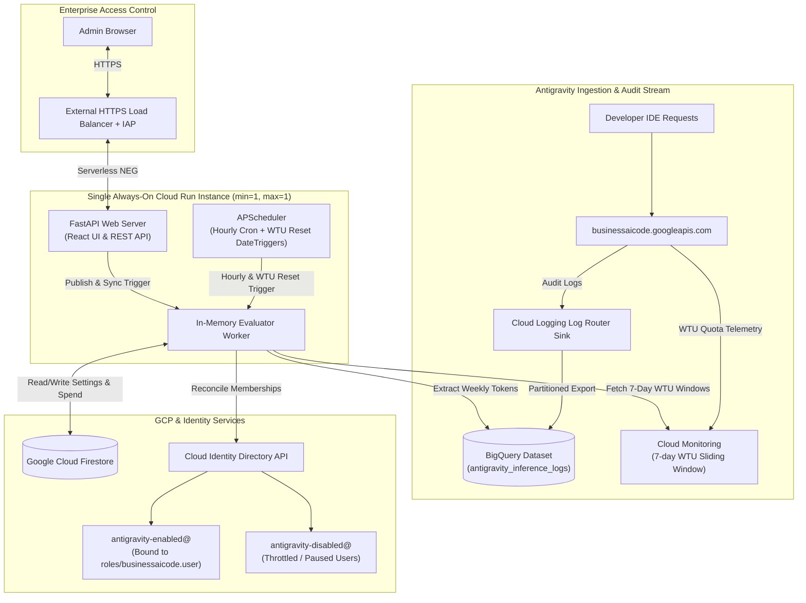
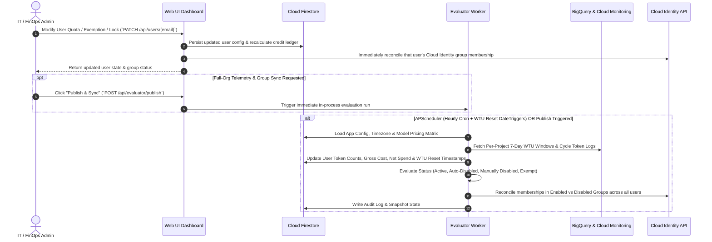
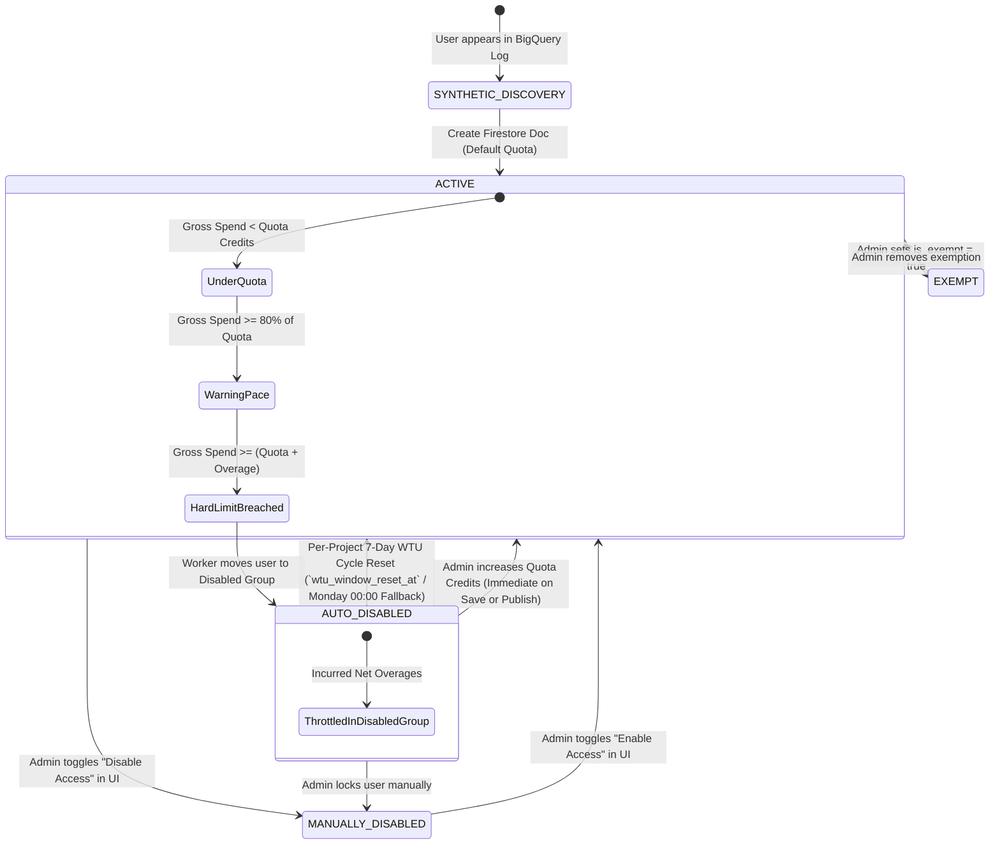
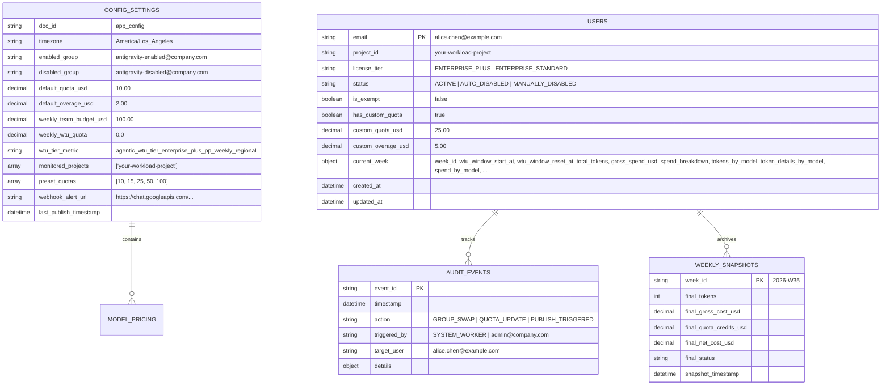

# Technical Design Document & Feature Specification: Antigravity Quota & Usage Management Portal

**Status**: APPROVED ARCHITECTURAL SPECIFICATION  
**Version**: 1.1.0  
**Target Platform**: Google Cloud Platform (Single Always-On Cloud Run Instance, Firestore, BigQuery, Cloud Identity)

---

## 1. Executive Summary & Objective

The **Antigravity Quota & Usage Management Portal** provides fine-grained visibility, credit tracking, cost estimation, and automated access governance for developer access to Google Antigravity (Gemini Enterprise AI Developer Tools).

> [!NOTE]
> **Independent Quota Approximation Layer with WTU Cycle Phase-Locking**: While this system does not modify internal Google Cloud Quotas enforcement, it integrates with Google Cloud Monitoring (`discoveryengine.googleapis.com/quota/ratev2/...`) to phase-lock each developer's **Weekly Reset** to their licensed workload project's 7-day WTU sliding cycle window (`window_start_time + 7 days`, with Monday `00:00:00` local time as fallback when no WTU window is active). Administrators define per-developer USD quota targets and enforce access governance via Cloud Identity groups based on estimated usage from BigQuery audit logs.

To minimize architectural complexity and infrastructure overhead, the system is deployed as a **single, always-on minimal Cloud Run instance** (`min-instances: 1`, `max-instances: 1`, 1 vCPU, 1Gi RAM). This single instance hosts:
1. **The Web Dashboard & REST API**: Instantaneous page loads with zero cold starts for admin users.
2. **The Embedded Background Worker**: Runs an internal scheduler (Python `APScheduler`) to evaluate quotas hourly and schedule dynamic one-shot **Weekly Reset** triggers aligned to each monitored project's 7-day WTU reset timestamp (`window_start_time + 7d`), completely eliminating the need for external Cloud Scheduler cron jobs.
3. **Instant Publish Handler**: Exposes an in-process trigger invoked whenever the admin clicks "Publish & Sync" in the UI.



---

## 2. Financial Ledger, Cost Calculation & Credit Mechanics

### 2.1 The Credit vs. Net Cost Model
In Antigravity enterprise deployments, user quotas are distributed as **credit allocations**. To provide accurate FinOps reporting, the system calculates both gross usage and net liability:

1. **Gross Estimated Cost ($C_{\text{gross}}$)**:
   * **Granular Token Telemetry & Context-Length Tiered Pricing (`>200K` tokens)**: When granular token fields (`prompt`, `candidates`, `cached`, `thoughts`) are present in the BigQuery inference metadata, effective non-cached input tokens ($\max(0, \text{prompt} - \text{cached})$), cached context tokens ($\text{cached}$), and output + reasoning tokens ($\text{candidates} + \text{thoughts}$) are priced directly across standard ($\le 200\text{K}$ prompt tokens: $P_{\text{in}}, P_{\text{out}}, P_{\text{cache}}$) and long-context ($> 200\text{K}$ prompt tokens: $P_{\text{in, >200K}}, P_{\text{out, >200K}}, P_{\text{cache, >200K}}$) tiers:
     $$C_{\text{gross}} = C_{\text{standard (\le 200K)}} + C_{\text{long-context (> 200K)}}$$
   * **Blended Rate Fallback ($R_{\text{blended}}$)**: For legacy or summarized records lacking granular token breakdowns (`fallback_tokens`), spend is estimated using the model's hinge ratios:
     $$\text{Blended Rate Per 1M Tokens } (R_{\text{blended}}) = (w_{\text{in}} \cdot P_{\text{in}}) + (w_{\text{out}} \cdot P_{\text{out}}) + (w_{\text{cache}} \cdot P_{\text{cache}})$$
     $$C_{\text{fallback}} = \frac{T_{\text{fallback}} \times R_{\text{blended}}}{1,000,000}$$

2. **Allocated Quota Credits ($Q$)**:
   The weekly credit amount granted to the developer (e.g. \$10.00).

3. **Remaining Credit Balance ($B_{\text{credit}}$)**:
   $$B_{\text{credit}} = \max(0, Q - C_{\text{gross}})$$

4. **Net Cost / Developer Overage ($C_{\text{net}}$)**:
   $$C_{\text{net}} = \max(0, C_{\text{gross}} - Q)$$
   *(Note: Because Gemini Enterprise utilizes pooled project-level quotas, $C_{\text{net}}$ measures an individual developer's consumption exceeding their allocated quota target, rather than external GCP billing liability.)*

5. **Throttling Condition**:
   A user exceeds allowed usage when their Gross Cost exceeds their Quota Credits plus their allowed Overage Buffer ($O$):
   $$\text{Throttled if: } C_{\text{gross}} \ge Q + O \quad \iff \quad C_{\text{net}} \ge O$$

### 2.2 Global Weekly Reset Alignment Banner
To provide clear operational visibility into how per-developer dollar quotas align with Google Cloud WTU cycles, the application features a **single, prominent alignment banner** pinned to the dashboard header:

> ℹ️ **Weekly Reset Alignment**: *Each developer's spend counter and auto-throttle un-lock are **phase-locked to their licensed project's 7-day GCP Weighted Token Units (WTU) sliding window reset** (`window_start_time` + 7d). When a project's weekly tokens replenish, throttled developers in that project are automatically restored to `ACTIVE`.*

---

## 3. Core Architecture & Workflow Model

### 3.1 The "Save" vs. "Publish & Sync" Admin Lifecycle

To provide responsive per-user governance alongside full-organization telemetry reconciliation, administrative actions in the web UI follow a **Per-User Immediate Sync & Full-Org Publish** pattern:



1. **Save User & Config Edits (`PATCH /api/users/{email}`, `PUT /api/config`, `PUT /api/config/pricing`)**: `PATCH /api/users/{email}` persists user quota overrides, overage amounts, project/tier assignments, and exemptions directly to Firestore and immediately reconciles that user's Cloud Identity group membership (`antigravity-enabled@` vs. `antigravity-disabled@`). `PUT /api/config` persists global settings and, when `default_quota_usd` or `default_overage_usd` changes, immediately recalculates non-custom users' credit ledgers, evaluates state transitions, and reconciles Cloud Identity groups. `PUT /api/config/pricing` (and `POST /api/config/pricing/reset`) immediately recalculates all users' spend, state transitions, and Cloud Identity group memberships in real time.
2. **Publish & Sync (`POST /api/evaluator/publish`)**: Immediately triggers an in-process full-org BigQuery telemetry evaluation, Cloud Monitoring WTU window refresh, and Cloud Identity group sync across all developers in real-time.
3. **Embedded Scheduled Run (`APScheduler`)**: The container's internal background scheduler (`APScheduler` with hourly cron + dynamic per-project WTU reset `DateTrigger` jobs) triggers the evaluator worker every hour and 5 seconds after each monitored project's `wtu_window_reset_at` timestamp without requiring external Cloud Tasks or Cloud Scheduler infrastructure.

---

## 4. Dual-Group Identity State Machine

### 4.1 Group Definitions & IAM Roles

| Group Email | GCP IAM Role Binding | Purpose |
| :--- | :--- | :--- |
| `antigravity-enabled@yourcompany.com` | `roles/businessaicode.user` | **Active Developers**: Grants permission to run Antigravity inference. |
| `antigravity-disabled@yourcompany.com` | *None* | **Throttled / Paused Developers**: Zero IAM privileges. Tracks all inactive developers for audit and notification lists. |

### 4.2 State Definitions & Transitions



### 4.3 State Matrix & Evaluator Action Rules

| State / Flag | Group Location | Evaluator Action on Quota Breach | Per-Project 7-Day WTU Cycle Reset (`wtu_window_reset_at` / Monday `00:00:00` Local Fallback) |
| :--- | :--- | :--- | :--- |
| **`ACTIVE`** (`is_exempt: false`) | `antigravity-enabled@` | If `C_gross >= Q + O`: Move to `antigravity-disabled@`, set state to `AUTO_DISABLED`. | Archive snapshot, reset cycle gross token spend to `$0.00`, and reset credit balance to `Q`. Remain in `antigravity-enabled@`. |
| **`AUTO_DISABLED`** | `antigravity-disabled@` | User is throttled. If Admin increases `Q` such that `C_gross < Q + O`: Move to `antigravity-enabled@`, set state to `ACTIVE`. | **Auto-Re-enable**: Archive snapshot, reset cycle counters, move user back to `antigravity-enabled@`, set state to `ACTIVE`. |
| **`MANUALLY_DISABLED`** | `antigravity-disabled@` | Manual lock. Evaluator never modifies group. | **Protected**: Archive snapshot and reset cycle counters, but user remains `MANUALLY_DISABLED` in `antigravity-disabled@`. |
| **`is_exempt: true`** | `antigravity-enabled@` | Quota checks bypassed. Usage is tracked and displayed, but user is never throttled (unless `MANUALLY_DISABLED`). | Archive snapshot and reset cycle counters. User remains in `antigravity-enabled@`. |

---

## 5. Token Cost Modeling Engine & "Hinge Points"

### 5.1 Externalized 13-Entry Pricing Catalog (`config/model_pricing.json`)

The portal loads its default 13-entry pricing catalog from [`config/model_pricing.json`](config/model_pricing.json), supporting both granular token telemetry (`promptTokenCount`, `candidatesTokenCount`, `cachedContentTokenCount`, `thoughtsTokenCount`) with context-length tiering (`<=200k` vs. `>200k` prompt tokens via `context_tier_threshold_tokens` and `*_price_gt_threshold_per_million`) and blended fallback ratios when granular counts are absent:

```json
{
  "models": {
    "gemini-3-pro": {
      "display_name": "Gemini 3.1 Pro / 3.0 Pro",
      "log_pattern": "%3-pro%",
      "input_price_per_million": 2.00,
      "output_price_per_million": 12.00,
      "cached_price_per_million": 0.20,
      "context_tier_threshold_tokens": 200000,
      "input_price_gt_threshold_per_million": 4.00,
      "output_price_gt_threshold_per_million": 18.00,
      "cached_price_gt_threshold_per_million": 0.40,
      "estimated_input_ratio": 0.70,
      "estimated_output_ratio": 0.20,
      "estimated_cached_ratio": 0.10
    },
    "gemini-3.8-flash": {
      "display_name": "Gemini 3.8 Flash",
      "log_pattern": "%3.8%flash%",
      "input_price_per_million": 0.75,
      "output_price_per_million": 3.75,
      "cached_price_per_million": 0.075,
      "estimated_input_ratio": 0.80,
      "estimated_output_ratio": 0.15,
      "estimated_cached_ratio": 0.05
    },
    "gemini-3.7-flash": {
      "display_name": "Gemini 3.7 Flash",
      "log_pattern": "%3.7%flash%",
      "input_price_per_million": 0.75,
      "output_price_per_million": 3.75,
      "cached_price_per_million": 0.075,
      "estimated_input_ratio": 0.80,
      "estimated_output_ratio": 0.15,
      "estimated_cached_ratio": 0.05
    },
    "gemini-3.6-flash": {
      "display_name": "Gemini 3.6 Flash",
      "log_pattern": "%3.6%flash%",
      "input_price_per_million": 0.75,
      "output_price_per_million": 3.75,
      "cached_price_per_million": 0.075,
      "estimated_input_ratio": 0.80,
      "estimated_output_ratio": 0.15,
      "estimated_cached_ratio": 0.05
    },
    "gemini-3.5-flash-lite": {
      "display_name": "Gemini 3.5 Flash-Lite",
      "log_pattern": "%3.5%flash%lite%",
      "input_price_per_million": 0.30,
      "output_price_per_million": 2.50,
      "cached_price_per_million": 0.03,
      "estimated_input_ratio": 0.80,
      "estimated_output_ratio": 0.15,
      "estimated_cached_ratio": 0.05
    },
    "gemini-3.5-flash": {
      "display_name": "Gemini 3.5 Flash",
      "log_pattern": "%3.5%flash%",
      "input_price_per_million": 1.50,
      "output_price_per_million": 9.00,
      "cached_price_per_million": 0.15,
      "estimated_input_ratio": 0.75,
      "estimated_output_ratio": 0.20,
      "estimated_cached_ratio": 0.05
    },
    "gemini-3.1-flash-lite": {
      "display_name": "Gemini 3.1 Flash-Lite",
      "log_pattern": "%3.1%flash%lite%",
      "input_price_per_million": 0.25,
      "output_price_per_million": 1.50,
      "cached_price_per_million": 0.025,
      "estimated_input_ratio": 0.80,
      "estimated_output_ratio": 0.15,
      "estimated_cached_ratio": 0.05
    },
    "gemini-3-flash": {
      "display_name": "Gemini 3 Flash",
      "log_pattern": "%3-flash%",
      "input_price_per_million": 0.50,
      "output_price_per_million": 3.00,
      "cached_price_per_million": 0.05,
      "estimated_input_ratio": 0.80,
      "estimated_output_ratio": 0.15,
      "estimated_cached_ratio": 0.05
    },
    "gemini-2.5-pro": {
      "display_name": "Gemini 2.5 Pro",
      "log_pattern": "%2.5%pro%",
      "input_price_per_million": 1.25,
      "output_price_per_million": 10.00,
      "cached_price_per_million": 0.125,
      "context_tier_threshold_tokens": 200000,
      "input_price_gt_threshold_per_million": 2.50,
      "output_price_gt_threshold_per_million": 15.00,
      "cached_price_gt_threshold_per_million": 0.25,
      "estimated_input_ratio": 0.70,
      "estimated_output_ratio": 0.20,
      "estimated_cached_ratio": 0.10
    },
    "gemini-2.5-flash": {
      "display_name": "Gemini 2.5 Flash",
      "log_pattern": "%2.5%flash%",
      "input_price_per_million": 0.30,
      "output_price_per_million": 2.50,
      "cached_price_per_million": 0.03,
      "estimated_input_ratio": 0.80,
      "estimated_output_ratio": 0.15,
      "estimated_cached_ratio": 0.05
    },
    "claude-opus-5.5": {
      "display_name": "Claude Opus 5.5",
      "log_pattern": "%opus%5.5%",
      "input_price_per_million": 4.00,
      "output_price_per_million": 20.00,
      "cached_price_per_million": 0.20,
      "estimated_input_ratio": 0.75,
      "estimated_output_ratio": 0.20,
      "estimated_cached_ratio": 0.05
    },
    "claude-sonnet-5.5": {
      "display_name": "Claude Sonnet 5.5",
      "log_pattern": "%sonnet%5.5%",
      "input_price_per_million": 2.00,
      "output_price_per_million": 10.00,
      "cached_price_per_million": 0.10,
      "estimated_input_ratio": 0.75,
      "estimated_output_ratio": 0.20,
      "estimated_cached_ratio": 0.05
    },
    "default_fallback": {
      "display_name": "Default Model Fallback",
      "log_pattern": "default",
      "input_price_per_million": 0.75,
      "output_price_per_million": 3.75,
      "cached_price_per_million": 0.075,
      "estimated_input_ratio": 0.80,
      "estimated_output_ratio": 0.15,
      "estimated_cached_ratio": 0.05
    }
  }
}
```

---

## 6. Timezone & Weekly Boundary Engine

### 6.1 WTU-Locked 7-Day Cycle & Timezone Fallback Normalization
* **WTU-Locked 7-Day Sliding Window (Primary)**: Each monitored workload project's active cycle window is anchored to its Cloud Monitoring Discovery Engine `window_start_time` (`active_cycle_start_utc` to `active_cycle_reset_utc = window_start_time + 7 days`).
* **Calendar Week Fallback**: When no active WTU sliding window is reported by Cloud Monitoring, the application falls back to a weekly window beginning at **Monday 00:00:00** and ending at **Sunday 23:59:59** in the configured global **App Timezone** (default: `America/Los_Angeles`).

### 6.2 BigQuery Sharded & Partitioned Extraction Query

`BigQueryUsageClient._check_table_patterns()` inspects dataset tables via `client.list_tables(...)` (cached with a 60s TTL) to detect whether date-sharded sink tables (`businessaicode_googleapis_com_inference_response_*`) and/or the time-partitioned table (`businessaicode_googleapis_com_inference_response`) exist. `fetch_weekly_usage()` executes the sharded query first with `_TABLE_SUFFIX` date pruning, and when the partitioned table is also present, executes a secondary query against the unsharded table using an `insertId NOT IN (...)` clause to exclude records already returned from the sharded tables before merging results via `_merge_records()` keyed by `(project_id, user_email, model_name)`. Each query extracts the originating workload `project_id`, filters events against that project's active cycle start timestamp (`CASE project_id WHEN ...`), aggregates total and `>200k` long-context token buckets (`prompt_tokens_gt_200k`, `candidates_tokens_gt_200k`, `cached_tokens_gt_200k`, `thoughts_tokens_gt_200k`), and tracks `fallback_tokens` for legacy rows lacking granular token sub-counts. Standard-context (`<=200k`) token counts are then computed as the remainder (`max(0, total - gt_200k)`) in `app/core/cost_model.py`.

```sql
-- Parametrized BigQuery Usage Aggregation (built by BigQueryUsageClient._build_usage_query)
-- Executed against `..._inference_response_*` (with _TABLE_SUFFIX filter) and/or
-- `..._inference_response` (with `insertId NOT IN (...)` cross-table deduplication when both exist)
WITH raw_events AS (
  SELECT
    timestamp,
    COALESCE(
      resource.labels.project_id,
      REGEXP_EXTRACT(logName, r'^projects/([^/]+)/'),
      @fallback_project_id
    ) AS project_id,
    LOWER(TRIM(REPLACE(labels.user_id, 'user:', ''))) AS user_email,
    COALESCE(labels.model, 'gemini-3.8-flash') AS model_name,
    TO_JSON_STRING(jsonpayload_v1_inferenceresponselog.metadata) AS meta_json
  FROM
    `{{PROJECT_ID}}.{{DATASET_NAME}}.businessaicode_googleapis_com_inference_response_*`
  WHERE
    timestamp >= @min_start_timestamp_utc
    AND timestamp <= @end_timestamp_utc
    AND _TABLE_SUFFIX BETWEEN FORMAT_TIMESTAMP('%Y%m%d', @min_start_timestamp_utc)
    AND FORMAT_TIMESTAMP('%Y%m%d', @end_timestamp_utc)
  QUALIFY ROW_NUMBER() OVER (
    PARTITION BY IF(insertId IS NOT NULL AND insertId != '', insertId, GENERATE_UUID())
    ORDER BY timestamp DESC
  ) = 1
),
parsed_events AS (
  SELECT
    timestamp,
    project_id,
    user_email,
    model_name,
    COALESCE(
      SAFE_CAST(JSON_VALUE(meta_json, '$.totalTokenCount') AS INT64),
      SAFE_CAST(JSON_VALUE(meta_json, '$.totaltokencount') AS INT64),
      0
    ) AS total_tokens,
    COALESCE(
      SAFE_CAST(JSON_VALUE(meta_json, '$.promptTokenCount') AS INT64),
      SAFE_CAST(JSON_VALUE(meta_json, '$.prompttokencount') AS INT64),
      0
    ) AS prompt_tokens,
    COALESCE(
      SAFE_CAST(JSON_VALUE(meta_json, '$.candidatesTokenCount') AS INT64),
      SAFE_CAST(JSON_VALUE(meta_json, '$.candidatestokencount') AS INT64),
      0
    ) AS candidates_tokens,
    COALESCE(
      SAFE_CAST(JSON_VALUE(meta_json, '$.cachedContentTokenCount') AS INT64),
      SAFE_CAST(JSON_VALUE(meta_json, '$.cachedcontenttokencount') AS INT64),
      0
    ) AS cached_tokens,
    COALESCE(
      SAFE_CAST(JSON_VALUE(meta_json, '$.thoughtsTokenCount') AS INT64),
      SAFE_CAST(JSON_VALUE(meta_json, '$.thoughtstokencount') AS INT64),
      0
    ) AS thoughts_tokens
  FROM
    raw_events
)
SELECT
  project_id,
  user_email,
  model_name,
  COUNT(1) AS request_count,
  SUM(
    CASE
      WHEN total_tokens > 0 THEN total_tokens
      ELSE prompt_tokens + candidates_tokens + thoughts_tokens
    END
  ) AS token_count,
  SUM(prompt_tokens) AS prompt_tokens,
  SUM(candidates_tokens) AS candidates_tokens,
  SUM(cached_tokens) AS cached_tokens,
  SUM(thoughts_tokens) AS thoughts_tokens,
  SUM(CASE WHEN prompt_tokens > 200000 THEN prompt_tokens ELSE 0 END) AS prompt_tokens_gt_200k,
  SUM(CASE WHEN prompt_tokens > 200000 THEN candidates_tokens ELSE 0 END) AS candidates_tokens_gt_200k,
  SUM(CASE WHEN prompt_tokens > 200000 THEN cached_tokens ELSE 0 END) AS cached_tokens_gt_200k,
  SUM(CASE WHEN prompt_tokens > 200000 THEN thoughts_tokens ELSE 0 END) AS thoughts_tokens_gt_200k,
  SUM(
    CASE
      WHEN (prompt_tokens + candidates_tokens + cached_tokens + thoughts_tokens) = 0
        THEN total_tokens
      ELSE 0
    END
  ) AS fallback_tokens,
  MAX(timestamp) AS last_active
FROM
  parsed_events
WHERE
  user_email IS NOT NULL
  AND user_email != ''
  AND NOT ENDS_WITH(user_email, '.gserviceaccount.com')
  AND timestamp >= (CASE project_id WHEN '{{WORKLOAD_PROJECT_ID}}' THEN TIMESTAMP('{{PROJECT_CYCLE_START_UTC}}') ELSE @start_timestamp_utc END)
GROUP BY
  project_id,
  user_email,
  model_name;
```

---

## 7. Firestore Database Schema

Firestore stores the application settings, user configurations, weekly consumption, and credit ledgers.



### 7.1 Firestore User Document (`users/{user_email}`)

```json
{
  "email": "alice.chen@example.com",
  "project_id": "your-workload-project",
  "license_tier": "ENTERPRISE_PLUS",
  "status": "ACTIVE",
  "is_exempt": false,
  "has_custom_quota": true,
  "custom_quota_usd": 25.00,
  "custom_overage_usd": 5.00,
  "current_week": {
    "week_id": "2026-W35",
    "wtu_window_start_at": "2026-08-24T07:00:00Z",
    "wtu_window_reset_at": "2026-08-31T07:00:00Z",
    "total_tokens": 3700000,
    "total_requests": 240,
    "gross_spend_usd": 8.79,
    "quota_credits_usd": 25.00,
    "remaining_credit_usd": 16.21,
    "net_billable_cost_usd": 0.00,
    "overage_buffer_usd": 5.00,
    "spend_breakdown": {
      "input_spend_usd": 4.00,
      "output_spend_usd": 4.71,
      "cached_spend_usd": 0.08,
      "input_tokens": 2600000,
      "output_tokens": 520000,
      "cached_tokens": 580000,
      "thoughts_tokens": 70000
    },
    "tokens_by_model": {
      "gemini-3-pro": 2500000,
      "gemini-3.8-flash": 1200000
    },
    "token_details_by_model": {
      "gemini-3-pro": {
        "total_tokens": 2500000,
        "prompt_tokens": 1800000,
        "candidates_tokens": 300000,
        "cached_tokens": 350000,
        "thoughts_tokens": 50000,
        "prompt_tokens_gt_200k": 0,
        "candidates_tokens_gt_200k": 0,
        "cached_tokens_gt_200k": 0,
        "thoughts_tokens_gt_200k": 0,
        "fallback_tokens": 0
      },
      "gemini-3.8-flash": {
        "total_tokens": 1200000,
        "prompt_tokens": 800000,
        "candidates_tokens": 150000,
        "cached_tokens": 230000,
        "thoughts_tokens": 20000,
        "prompt_tokens_gt_200k": 0,
        "candidates_tokens_gt_200k": 0,
        "cached_tokens_gt_200k": 0,
        "thoughts_tokens_gt_200k": 0,
        "fallback_tokens": 0
      }
    },
    "spend_by_model": {
      "gemini-3-pro": 7.87,
      "gemini-3.8-flash": 0.92
    },
    "credit_utilization_percentage": 35.16,
    "last_active": "2026-08-27T11:42:10Z"
  },
  "created_at": "2026-08-01T09:00:00Z",
  "updated_at": "2026-08-27T12:00:00Z"
}
```

---

## 8. Web Application UI/UX Specification

### 8.1 Global Weekly Reset Alignment Banner
* **Pinned Top Banner**: Displayed once at the top of the portal (`DisclaimerBanner.tsx`):
  * *"ℹ️ **Weekly Reset Alignment**: Each developer's spend counter and auto-throttle un-lock are **phase-locked to their licensed project's 7-day GCP Weighted Token Units (WTU) sliding window reset** (`window_start_time` + 7d). When a project's weekly tokens replenish, throttled developers in that project are automatically restored to `ACTIVE`."*

### 8.2 Main Dashboard (User Management Table)

*   **KPI Summary Chips**:
    *   `Active Developers`: 178
    *   `Auto-Throttled`: 4
    *   `Total Tokens This Week`: 128.4M
    *   `Total Gross Usage`: \$1,420.50 *(Estimated)*
    *   `Total Credits Allocated`: \$1,780.00
    *   `Total Net Overages`: \$64.20 *(Billable Spend)*

*   **User Management Table Columns (`UserTable.tsx` — 11 Columns, 5 Sortable)**:
    The 5 sortable columns are **`Developer`** (`email`), **`Cycle Tokens`** (`tokens`), **`Gross Usage`** (`gross_spend`), **`Credit Balance / Net Overage`** (`remaining_credit`), and **`Credit Utilization`** (`utilization`).

| Column Name | Data Type | Sortable | Display / Visual Elements |
| :--- | :--- | :---: | :--- |
| **Developer** | String (`email`) | Yes | Avatar + Developer Email (`alice.chen@example.com`) + `Custom Quota` badge when enabled |
| **Licensed Project & Tier** | String / Enum | No | Workload Project ID chip (`your-workload-project`) + Tier badge (`Enterprise Plus` / `Enterprise Standard`) |
| **Status** | Enum | No | 🟢 `Active` \| 🟡 `Warning (>80%)` \| 🔴 `Auto-Throttled` \| 🔒 `Locked` \| ⚪ `Exempt` |
| **Weekly Reset** | Timestamp | No | Per-project 7-day WTU reset timestamp & countdown (`Resets in Xd Yh` / `Auto-Restores in Xd Yh` / `Locked across resets`) |
| **Cycle Tokens** | Integer (`tokens`) | Yes | Formatted with commas (`3,700,000`) |
| **Gross Usage** | Currency (`gross_spend`) | Yes | Gross spend for the active cycle (**\$8.79**) |
| **Quota Credits** | Currency | No | Allocated weekly quota credit target (**\$25.00**) |
| **Credit Balance / Net Overage** | Currency (`remaining_credit`) | Yes | If `C_gross <= Q`: **\$16.21 Left** 🟢<br>If `C_gross > Q`: **+\$2.40 Net Overage** 🔴 |
| **Credit Utilization** | Percentage (`utilization`) | Yes | Progress bar (`<80% Green`, `80-100% Amber`, `>100% Red`) + utilization percentage (`35%`) |
| **Last Active** | Relative Time | No | Relative timestamp (`Just now`, `15m ago`, `2h ago`, `3d ago`, or `Inactive`) |
| **Actions** | Action Menu | No | `[ Edit Quota & Settings ]` \| `[ Lock / Disable Access ]` \| `[ Set as Exempt ]` |

### 8.3 User Detail Slide-out Drawer (`UserDrawer`)
Clicking any user row opens a slide-out drawer containing:
1.  **Financial & Quota Ledger**:
    *   **Gross Token Value**: \$8.79 (`3,700,000 tokens`)
    *   **Allocated Credits**: \$25.00 (`+$5.00 Buffer`)
    *   **Remaining Balance**: \$16.21
    *   **Net Quota Overage**: \$0.00
    *   *(Optional)* **Per-User WTU Quota (`LocalizedUser`)**: Displayed when per-user WTU telemetry is active.
2.  **Model Token & Spend Distribution**: Per-model total spend and token counts (`$spend (tokens)`) with horizontal `LinearProgress` bars (`gemini-3-pro` vs `gemini-3.8-flash`).
3.  **Granular Token & Cost Distribution**: 3-column grid displaying **Input (Prompt)**, **Output + Thoughts** (with reasoning token count), and **Cached Context** dollar spend and token counts.
4.  **Developer Governance & Quota Overrides**:
    *   Licensed Workload Project ID (`project_id`) & License Tier (`Enterprise Plus` / `Enterprise Standard`) selector.
    *   `Enable Custom Quota Limit` Switch, Weekly Credit Presets radio buttons (\$10, \$15, \$25, \$50, \$100, or Custom), Quota Limit (\$) input, and Overage Buffer (\$) input.
    *   `Exempt from Quota Throttling` Switch.
    *   `Manually Lock Access` Switch.
    *   `[ Save Changes ]` Button (persists to Firestore and immediately reconciles that user's Cloud Identity group membership).

---

## 9. Security & Minimal Privilege IAM Model

| Identity / Service Account | Granted IAM Roles | Scoped Resource | Purpose |
| :--- | :--- | :--- | :--- |
| **Cloud Run Unified SA** (`antigravity-quota-portal@...`) | `roles/bigquery.dataViewer` *(dataset-scoped)* | Central BigQuery Dataset (`antigravity_inference_logs` via `google_bigquery_dataset_iam_member.bq_data_viewer`) | Reads inference audit log tables strictly within the `antigravity_inference_logs` dataset (no project-wide BigQuery data read access). |
| **Cloud Run Unified SA** (`antigravity-quota-portal@...`) | `roles/bigquery.jobUser`<br>`roles/datastore.user`<br>`roles/logging.logWriter`<br>`roles/monitoring.viewer`<br>`roles/serviceusage.serviceUsageConsumer` | Host Portal Project (`your-portal-project`) | Executes BigQuery query jobs, reads/writes Firestore state, emits structured audit logs, and queries Cloud Monitoring with user-project quota attribution. |
| **Cloud Run Unified SA** (`antigravity-quota-portal@...`) | `roles/monitoring.viewer` | Monitored Workload Projects (`var.monitored_project_ids`) | Queries Discovery Engine 7-day WTU sliding window metrics (`discoveryengine.googleapis.com/quota/ratev2/...`). |
| **Cloud Run Unified SA** (`antigravity-quota-portal@...`) | Cloud Identity **Group Manager** | `antigravity-enabled@`<br>`antigravity-disabled@` | Swaps group memberships via Google Cloud Identity API. **Zero GCP project IAM admin rights.** |
| **Cloud Logging Sink Writer Identities** (`serviceAccount:p<project_num>-...@gcp-sa-logging.iam.gserviceaccount.com`) | `roles/bigquery.dataEditor` | Central BigQuery Dataset (`antigravity_inference_logs`) | Exports `businessaicode.googleapis.com` inference logs from each monitored workload project into the central BigQuery dataset. |
| **Enabled Developers Group** (`group:antigravity-enabled@...`) | `roles/businessaicode.user` | Monitored Workload Projects (`var.monitored_project_ids`) | Authorizes active developers to execute Antigravity inference in their licensed workload project. |

---

## 10. Summary & Sign-off

The specification now fully formalizes:
1. **The Credit vs. Overage Model**: User quotas are treated as granted credits. Overage accumulates when gross usage exceeds the quota ($C_{\text{gross}} - Q$), tracking internal developer overage against policy targets rather than external pooled billing.
2. **Unified Estimation Disclaimer**: Prominently presented at the application level rather than fragmenting every metric on the page.
3. **Dual-Group Cloud Identity Model**: Complete state transitions across `ACTIVE`, `AUTO_DISABLED`, `MANUALLY_DISABLED`, and `is_exempt`.
4. **Per-User Immediate Sync & Full-Org Publish Workflow**: Saving user edits (`PATCH /api/users/{email}`) immediately persists to Firestore and reconciles that user's Cloud Identity group membership, while clicking **Publish & Sync** (`POST /api/evaluator/publish`) triggers an immediate full-org BigQuery telemetry evaluation and Cloud Identity group sync across all developers.
